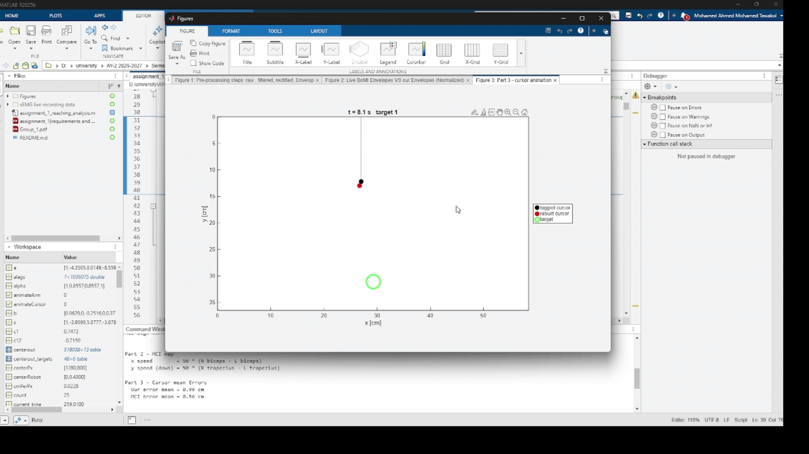

# Assignment 1 - Steering a cursor with four muscles

Biomedical Robotics - Group 1 (Mohamed Tawakol Ahmed, Paolo Nicolini, Endri Gjinaj)

## Demo

*Video file: [`cursor_control.mp4`](cursor_control.mp4)*

## Credits
The code skeleton (`assignment_1_reaching_analysis.m`) was written by the Teaching Assistant **Federica Sassi** (PhD student, bioengineering, UniGe). We only completed the parts marked "YOUR CODE HERE", and added the comments and figures.

## What we did
- **Part 1 - Envelopes:** remove DC offset, band-pass 10-450 Hz (butter, filtfilt), rectify, low-pass 5 Hz, normalize by MAX (with a small gain). We compared them with the MCI live envelopes: correlation 0.80 - 0.96 and a lag of about 36 - 42 ms (our signal leads because filtfilt has zero delay).
- **Part 2 - MCI map:** we used the given map, velocity = gain * env * W'.
- **Part 3 - Cursor:** 5% dead zone, integrate the velocity into a position, clip to the screen and reset at each new target. Compared with the logged cursor, the final mean error is **0.99 cm** (centerout) and **0.85 cm** (random).
- **Part 4 - Performance:** reach time and overshoots for each target.
- **Bonus - Robot arm:** the rebuilt cursor drives a 2-link arm with the Jacobian (resolved-rate control).

## Files
- `assignment_1_reaching_analysis.m` : commented code
- `Group_1.mat` : sEMG recorded data.
- `Group_1.pdf` : Results, figures and comments.

## How to run
1. Put `Group_1.mat` in the path set in `matFile`.
2. Choose `task = 'centerout'` or `'random'`.
3. Run the script (needs the Signal Processing Toolbox). Set `animateCursor` / `animateArm` to `true` to see the animations.

